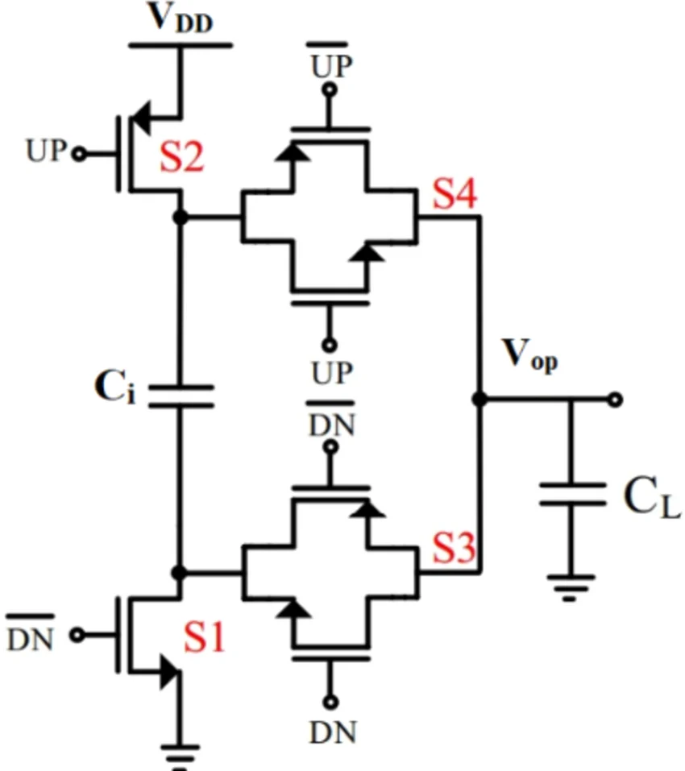

# Switch-Based CMOS Charge Pump — Complete Project Guide

## Project title

**Design and Simulation Analysis of a Switch-Based CMOS Charge Pump Using Cadence Virtuoso**

## Team

- **Pragyan Jain** — 24BLC1100
- **Shivam Kumar** — 24BLC1103
- **K Navin Aakash** — 23BLC1238

## Project status

This document describes the project plan prepared for **Review 1 of 3**.

At this stage:

- The charge-pump idea has been studied.
- A circuit has been selected.
- The purpose of each circuit part has been identified.
- The simulation steps and analyses have been planned.
- No final waveform, measured value, or performance result is being claimed yet.

The circuit will be created and tested entirely in **Cadence Virtuoso**. The project does not include chip manufacturing, physical fabrication, or laboratory testing of a manufactured device.

---

## 1. Project in one paragraph

This project studies a circuit called a **charge pump**. It uses electronic switches and capacitors to move small amounts of electrical charge. Two control signals, called **UP** and **DN**, tell the circuit whether the output voltage should rise or fall. A capacitor at the output stores the transferred charge and keeps the voltage reasonably smooth between control commands. We will build this circuit in Cadence Virtuoso, apply different UP and DN signals, observe the output, and then change the switch sizes, capacitor values, signal timing, supply voltage, temperature, and device settings. The aim is to find a simulated design that gives a useful balance of stable output, quick response, low unwanted variation, and reasonable power use.

## 2. Why this project is useful

Many electronic systems need a voltage that can be adjusted in small steps. A charge pump can perform this adjustment without using a coil or another large magnetic part. The selected circuit can move the output voltage upward when it receives an UP command and downward when it receives a DN command.

This type of circuit is useful in control systems where another part of the system decides whether a voltage is too low or too high. The charge pump receives that decision and changes the voltage accordingly. For example, a timing-control system can use an adjustable voltage to correct whether an internal signal is running too slowly or too quickly.

The project is valuable because it shows how a small set of switches and capacitors can convert digital commands—UP and DN—into a changing voltage.

## 3. Main objective

The main objective is to:

> Build the selected charge-pump circuit in Cadence Virtuoso, understand its UP, DN, and hold actions, and study how its main settings affect the output.

More specifically, the project will:

1. Recreate the selected circuit using individual transistor switches and capacitors.
2. Prepare a simulation setup that can apply controlled UP and DN pulses.
3. Confirm that an UP command moves the output voltage upward.
4. Confirm that a DN command moves the output voltage downward.
5. Check how well the output stays steady when neither action is requested.
6. Measure response time, settling time, output variation, unwanted spikes, and power use.
7. Change one setting at a time to understand why the output changes.
8. Test the circuit under different simulated supply, temperature, and device conditions.
9. Compare all simulation cases and choose a practical final setup.

## 4. Project boundaries

### Included

- Drawing the circuit in Cadence Virtuoso.
- Creating the UP and DN control signals.
- Creating a testbench around the circuit.
- Running time-based simulations.
- Changing switch sizes and capacitor values.
- Changing pulse width and pulse frequency.
- Changing the output load.
- Testing lower, normal, and higher supply values.
- Testing cold, room, and hot temperature settings.
- Testing typical, faster, and slower device-model settings provided in Cadence.
- Comparing the simulation waveforms and measured values.
- Selecting final simulated component values.

### Not included

- Manufacturing a chip.
- Fabricating a physical circuit.
- Creating a production mask set.
- Physical laboratory measurement of a manufactured sample.
- Claiming that planned or expected behavior is already a measured result.

This is a **simulation-only Cadence Virtuoso project**.

---

## 5. The selected circuit

The selected diagram contains four switches, an internal capacitor, an output capacitor, a supply connection, ground, control signals, and an output.

### Important labels in the diagram

| Label | Simple meaning | Job in the circuit |
|---|---|---|
| **VDD** | The power supply | Provides the electrical energy used by the circuit. |
| **Ground** | The low reference level | Provides the lower electrical reference. |
| **UP** | Raise command | Tells the pump to move the output upward. |
| **DN** | Lower command | Tells the pump to move the output downward. |
| **UP with a bar** | Opposite form of UP | Helps paired switches open and close correctly. |
| **DN with a bar** | Opposite form of DN | Helps paired switches open and close correctly. |
| **S1, S2, S3, S4** | Electronic switches | Connect and disconnect paths at the correct time. |
| **Ci** | Internal transfer capacitor | Temporarily holds charge so it can be moved. |
| **CL** | Output or load capacitor | Stores charge at the output and smooths the output voltage. |
| **Vop** | Output voltage | The voltage produced and controlled by the pump. |

The bar above a signal name means its opposite. When one form is active, the other form is inactive. A paired arrangement helps the circuit control a switch cleanly.

### A note about the name “charge pump”

The name **charge pump** is used for more than one kind of circuit. Some charge pumps are voltage boosters that try to create a voltage above the supply. The selected S1–S4 diagram is better understood as an **UP/DN control charge pump**: it transfers small amounts of charge to or from the output so that the output voltage can be adjusted. This project focuses on that selected UP/DN circuit.

---

## 6. Basic idea behind the pump

A capacitor can store electrical charge for a short time. The switches decide where that charge can move.

An everyday comparison is moving water with small cups:

- The supply is like a water source.
- The internal capacitor **Ci** is like a small cup used for transfer.
- The switches are like controlled valves.
- The output capacitor **CL** is like a storage tank.
- An UP command adds a small amount to the tank.
- A DN command removes a small amount from the tank.
- When no command is given, the tank should keep nearly the same level.

The circuit repeats these small transfers. Therefore, a longer UP or DN command, or a larger number of command pulses, produces a larger total change at the output.

## 7. Role of each main part

### 7.1 Switches S1–S4

S1–S4 are made using transistors, but a beginner can think of them as very fast automatic ON/OFF switches.

- **S1 and S2** help connect the internal part of the pump toward the lower or upper supply level.
- **S3 and S4** help connect the internal transfer path to the output.
- The UP, DN, and opposite control signals decide which paths are open.
- Correct timing prevents an unwanted direct path between the power supply and ground.

The switch sizes matter. A larger switch may move charge more easily and respond faster, but it can also use more power and disturb the output more when it changes state. A smaller switch may use less power, but it can make the response slower.

### 7.2 Internal capacitor Ci

**Ci** is the charge-transfer part of the pump.

- It temporarily stores a small amount of charge.
- The switch arrangement changes which side of Ci is connected to the supply, ground, or output.
- This controlled reconnection allows charge to be delivered to or removed from the output.

A larger Ci can move more charge during an action, so the output may change more strongly. However, a very large capacitor can take longer to charge, use more area in a real design, and increase the work the switches must do. Although this project does not include manufacturing, area remains a useful simulated design consideration because very large components are generally less practical.

### 7.3 Output capacitor CL

**CL** stores charge at the output.

- It keeps the output from changing too sharply.
- It helps hold the voltage between UP and DN commands.
- It reduces rapid unwanted movement at the output.

A larger CL will normally make the output smoother, but each UP or DN action may then change the output more slowly. A smaller CL may respond quickly but may show more ripple or sharper voltage steps.

### 7.4 Control signals

The circuit uses UP, DN, and their opposite forms.

- An **UP request** should make the output rise.
- A **DN request** should make the output fall.
- With **no request**, the output should remain close to its previous value.

During simulation, the opposite versions of UP and DN must change in the correct order. A small timing gap may be added if necessary so that switches that should not be ON together do not overlap.

---

## 8. How the pump works step by step

The exact ON/OFF state of an individual transistor depends on whether it is a top-side or bottom-side switch and whether it receives the normal or opposite control signal. For a first reading, it is more useful to follow the three overall operating states.

### 8.1 UP state — raising the output

1. The UP control and its opposite signal place the upper switch path in its UP arrangement.
2. The supply provides charge to the internal transfer section.
3. The internal capacitor Ci temporarily supports this charge transfer.
4. The correct output-side switch connects the transfer path to Vop.
5. Charge is delivered to the output capacitor CL.
6. Because CL receives additional charge, Vop rises by a small amount.
7. Repeated UP pulses continue moving Vop upward until the pulses stop or the circuit reaches its operating limit.

What we expect to see later in Cadence: each valid UP action should cause a controlled upward movement in the Vop waveform.

### 8.2 DN state — lowering the output

1. The DN control and its opposite signal place the lower switch path in its DN arrangement.
2. The output-side path is connected so that charge can leave CL.
3. The internal capacitor and lower switches guide that charge toward the lower reference.
4. CL loses a small amount of stored charge.
5. Vop falls by a small amount.
6. Repeated DN pulses continue moving Vop downward until the pulses stop or the lower operating limit is reached.

What we expect to see later in Cadence: each valid DN action should cause a controlled downward movement in the Vop waveform.

### 8.3 Hold state — keeping the output nearly steady

1. Neither an UP transfer nor a DN transfer is requested.
2. The output should be isolated as much as possible from the supply and ground paths.
3. CL keeps its stored charge.
4. Vop should remain close to the value reached by the previous command.

The output may not stay perfectly flat in simulation. Tiny unwanted current paths and switch movement can cause slow drift or small spikes. Measuring that behavior is part of the project.

### 8.4 What if UP and DN arrive together?

This is an important test case. If UP and DN overlap, the circuit may try to add and remove charge at nearly the same time. That can waste power, create an unwanted spike, or produce an uncertain output movement.

We will therefore:

- Test an overlap case in simulation.
- Observe the output and supply current.
- Decide whether the input timing needs a small safety gap.
- Clearly define which input combinations are valid for the final testbench.

---

## 9. Cadence Virtuoso implementation plan

### Step 1 — Create the circuit page

- Start a new design library and circuit cell in Cadence Virtuoso.
- Place the transistor devices used for S1–S4.
- Add Ci and CL.
- Add VDD and ground.
- Connect all parts exactly as shown in the selected diagram.
- Label UP, opposite-UP, DN, opposite-DN, and Vop clearly.

### Step 2 — Check the drawing

- Check that every wire reaches the intended point.
- Check that no wire is left floating by mistake.
- Check that each transistor control terminal is connected to the correct signal.
- Check that the supply and ground connections are correct.
- Use Cadence’s circuit-checking features to catch drawing errors before simulation.

### Step 3 — Create a reusable symbol

The completed charge-pump circuit can be represented by one simple block with input and output pins. This makes the testbench easier to read.

Suggested visible pins:

- VDD
- Ground
- UP
- Opposite-UP
- DN
- Opposite-DN
- Vop

### Step 4 — Build the testbench

The testbench is the simulation environment around the pump. It will contain:

- A DC supply for VDD.
- Pulse sources for UP and DN.
- Logic needed to provide opposite-UP and opposite-DN, or separate synchronized pulse sources.
- The selected CL value if it is not already inside the pump block.
- An adjustable output load.
- Measurement points for Vop and supply current.

### Step 5 — Set a starting condition

The first simulation needs a known starting point. We will either:

- Allow the output to begin from zero and observe startup, or
- Set a chosen starting voltage when a mid-range response is being studied.

The chosen method will be written next to each result so the waveforms can be compared fairly.

### Step 6 — Run the base simulation

Use one starting set of switch sizes, Ci, CL, supply, temperature, and pulse timing. Apply:

1. A quiet starting period.
2. Several UP pulses.
3. Another quiet period.
4. Several DN pulses.
5. A final quiet period.

This one run should make the basic UP, DN, and hold actions easy to see.

### Step 7 — Save the base case

Record all starting values and save the base waveform. Every later change will be compared with this same reference case.

### Step 8 — Change one item at a time

Only one main setting should be changed for each simple comparison. This prevents confusion about which change caused the result.

### Step 9 — Run combined-condition checks

After individual effects are understood, promising settings will be tested together under lower and higher supply, different temperatures, and different device-model settings.

### Step 10 — Select the final simulated setup

The final choice will not be based on output voltage alone. It will balance:

- Correct UP and DN direction.
- Stable hold behavior.
- Useful response speed.
- Small ripple and spikes.
- Reasonable power use.
- Reliable behavior across the planned simulation conditions.

---

## 10. Simple test sequence

| Stage | Action | What will be recorded |
|---|---|---|
| **1. Build** | Draw switches, capacitors, supply, and UP/DN inputs. | Circuit and testbench settings. |
| **2. Run** | Apply UP, DN, and quiet periods. | UP, DN, Vop, and supply-current waveforms. |
| **3. Record** | Mark important points on the waveform. | Voltage change, response time, settling time, ripple, spikes, and power. |
| **4. Compare** | Change one component or condition. | Difference from the base case. |
| **5. Select** | Compare all useful cases. | Final simulated component and timing choices. |

---

## 11. Analyses we will perform

No result is stated in this section. It explains what will be tested in Reviews 2 and 3 and why each test matters.

### 11.1 Basic function check

**Purpose:** Confirm that the circuit performs its three main jobs.

**Test:**

- Apply UP pulses only.
- Apply DN pulses only.
- Apply no pulses for a hold period.

**Observe:**

- Does Vop rise during UP?
- Does Vop fall during DN?
- Does Vop remain nearly steady during hold?
- Is the movement repeatable for similar pulses?

This is the first and most important check. Other comparisons are useful only after the circuit passes this test.

### 11.2 Output-voltage movement over time

**Purpose:** See the full behavior from startup through UP, hold, DN, and final hold.

**Observe:**

- Starting voltage.
- Highest and lowest reached voltage.
- Shape of each upward and downward step.
- Whether the output moves smoothly or suddenly.
- Whether the output stops moving when the commands stop.

The main plot will show UP, DN, and Vop on the same time line.

### 11.3 UP response analysis

**Purpose:** Measure how effectively an UP command raises the output.

**Change:** Number of UP pulses, pulse width, and pulse frequency.

**Observe:**

- Voltage increase caused by one pulse.
- Total increase caused by several pulses.
- Delay between the UP command and visible output movement.
- Whether later pulses act differently when Vop is already high.

### 11.4 DN response analysis

**Purpose:** Measure how effectively a DN command lowers the output.

**Change:** Number of DN pulses, pulse width, and pulse frequency.

**Observe:**

- Voltage decrease caused by one pulse.
- Total decrease caused by several pulses.
- Delay between the DN command and visible output movement.
- Whether later pulses act differently when Vop is already low.

### 11.5 UP and DN balance

**Purpose:** Check whether similar UP and DN commands produce reasonably similar amounts of change in opposite directions.

**Test:** Apply matched UP and DN pulse groups around the same starting voltage.

**Observe:**

- Upward change per UP pulse.
- Downward change per DN pulse.
- Any large difference between the two directions.

Perfect equality may not be possible, but a large imbalance could make the controlled system behave unevenly.

### 11.6 Hold and drift analysis

**Purpose:** Check how well CL keeps the output voltage when no command is active.

**Test:** Move Vop to a selected value, stop UP and DN activity, and wait.

**Observe:**

- Slow upward or downward drift.
- Sudden small changes when the switches turn off.
- Time for the output to move outside a chosen acceptable band.

This shows whether the output can remember its value between commands.

### 11.7 Rise time, fall time, and settling time

These measurements describe speed without using complicated mathematics.

- **Rise time:** How long the output takes to complete most of an upward movement.
- **Fall time:** How long the output takes to complete most of a downward movement.
- **Settling time:** How long the output takes to stop visibly changing after a command sequence.

**Purpose:** Find settings that respond quickly without causing excessive ripple, spikes, or power use.

### 11.8 Output ripple analysis

**Ripple** means a repeated small movement around the desired output level.

**Purpose:** Check how smooth Vop is during repeated operation or a hold period.

**Change:** CL, Ci, pulse frequency, and output load.

**Observe:** Difference between the small high and low points of Vop after the main movement has settled.

### 11.9 Unwanted spike analysis

Switches can briefly disturb the output when they turn ON or OFF. This may appear as a narrow peak or dip.

**Purpose:** Identify whether command edges create large unwanted jumps.

**Change:** Switch size, signal-edge speed, overlap gap, Ci, and CL.

**Observe:**

- Size of the positive or negative spike.
- How long it lasts.
- Whether it appears during UP, DN, or both.

### 11.10 Switch-size analysis

**Purpose:** Understand the balance between fast charge movement and unwanted switching effects.

**Test:** Use smaller, middle, and larger versions of S1–S4 while keeping other settings unchanged.

**Observe:**

- Output change per pulse.
- Rise and fall response.
- Settling time.
- Ripple and spikes.
- Power use.

Expected question—not a result: Do larger switches improve useful response enough to justify their extra power and disturbance?

### 11.11 Internal-capacitor Ci analysis

**Purpose:** See how the transfer-capacitor value changes the amount of charge moved.

**Test:** Try a small, medium, and large Ci.

**Observe:**

- UP and DN voltage step size.
- Response time.
- Power use.
- Effect on spikes and output smoothness.

### 11.12 Output-capacitor CL analysis

**Purpose:** Find a useful balance between output smoothness and response speed.

**Test:** Try a small, medium, and large CL.

**Observe:**

- Ripple.
- Voltage change per pulse.
- Rise, fall, and settling time.
- Hold behavior.

Expected question—not a result: Does a larger CL make the output smoother but slower?

### 11.13 Pulse-width analysis

**Pulse width** is how long an UP or DN command stays active.

**Purpose:** Find whether very short pulses transfer too little charge and whether very long pulses waste time or power.

**Observe:** Output movement per pulse, response delay, spikes, and energy used during the active period.

### 11.14 Pulse-frequency analysis

**Pulse frequency** describes how often control pulses arrive.

**Purpose:** See how the pump behaves when commands come slowly or rapidly.

**Test:** Use low, middle, and high pulse rates within the chosen simulation range.

**Observe:**

- Speed of total output movement.
- Ripple.
- Settling behavior.
- Power use.
- Whether the output can follow every command at the highest rate.

### 11.15 Signal overlap and timing-gap analysis

**Purpose:** Prevent conflicting paths when one command ends and another begins.

**Test:**

- No overlap between UP and DN.
- A small safe gap between commands.
- A deliberate overlap case for comparison.

**Observe:** Output spikes, incorrect movement, and short power-current peaks.

### 11.16 Output-load analysis

The output load represents another circuit connected to Vop. A heavier load asks more from the pump.

**Purpose:** Check whether Vop remains useful when the connected load changes.

**Test:** Light, medium, and heavier simulated loads.

**Observe:**

- Achieved output level.
- Step size.
- Ripple.
- Hold drift.
- Response and settling time.
- Power use.

### 11.17 Power-use analysis

**Purpose:** Measure how much power the circuit takes from the supply during operation.

**Test:** Record supply voltage and supply current for the base case and every major comparison.

**Observe:**

- Power during UP activity.
- Power during DN activity.
- Power during hold.
- Average power across a complete test sequence.
- Short current peaks caused by switching or overlapping commands.

The preferred design should not use a large amount of extra power for only a small improvement in speed.

### 11.18 Efficiency comparison

For this project, efficiency will be used mainly as a **comparison tool**. We will compare the useful change delivered at the output with the energy taken from the supply under the same test conditions.

This comparison must use identical starting voltage, load, command pattern, and observation time. Otherwise, the cases would not be fair.

### 11.19 Supply-voltage analysis

**Purpose:** Check whether a modest supply change causes the pump to stop working or behave incorrectly.

**Test:**

- Lower supply.
- Normal supply.
- Higher supply.

**Observe:** Startup, UP movement, DN movement, hold stability, response time, ripple, spikes, and power.

Exact voltage values will be chosen from the device library limits and project requirements before the simulations are run.

### 11.20 Temperature analysis

Electronic switches behave differently when the simulated temperature changes.

**Purpose:** Check whether the chosen setup remains usable in cold, room, and hot conditions.

**Observe:**

- Response speed.
- Voltage step size.
- Hold drift.
- Output ripple.
- Power use.

Exact temperature values will be stated with the results in a later review.

### 11.21 Device-model analysis

Cadence can represent devices that act typically, slightly faster, or slightly slower because real devices are not all exactly identical.

**Purpose:** Check whether the result depends too strongly on one ideal device setting.

**Test:** Typical, faster, and slower device models available in the selected Cadence library.

**Observe:** Correct operation, output step size, speed, drift, ripple, and power.

### 11.22 Combined-condition analysis

Individual checks explain one effect at a time. A final robust design must also work when several conditions change together.

Promising component settings will therefore be checked under combinations such as:

- Lower supply with a slower device model.
- Higher supply with a faster device model.
- Hot temperature with a heavier load.
- Cold temperature with the chosen pulse timing.

The exact combinations will follow the limits supported by the Cadence device library.

### 11.23 Repeated-run variation, if supported

If the selected Cadence models support repeated statistical runs, we may perform an additional check in Review 3. Cadence will make small random changes to device behavior in each run.

**Purpose:** See whether most simulated copies behave similarly or whether the result varies widely.

**Observe:** Spread in output step size, settling time, ripple, and power.

This is an optional simulation analysis, not a manufacturing activity.

---

## 12. Main settings we will change

| Setting | Planned change | Reason for changing it |
|---|---|---|
| S1–S4 size | Smaller, middle, larger | Compare response, power, and unwanted spikes. |
| Ci | Small, medium, large transfer value | Compare how much charge is moved per action. |
| CL | Small, medium, large output value | Compare smoothness, hold, and settling time. |
| UP/DN pulse width | Shorter to longer | Find a useful active time. |
| UP/DN frequency | Slower to faster | Check response speed and power use. |
| Timing gap | Small gap, no gap, deliberate overlap | Check safe switching. |
| Output load | Light to heavier | Check whether Vop remains stable. |
| Supply | Lower, normal, higher | Check operation away from the normal supply. |
| Temperature | Cold, room, hot | Check behavior across temperature settings. |
| Device model | Typical, faster, slower | Check sensitivity to device behavior. |

Exact numeric ranges are not invented in Review 1. They will be selected using the allowed limits of the device library and documented before the simulation results are presented.

## 13. What we will measure

| Measurement | Plain-language meaning | Why it matters |
|---|---|---|
| Output voltage | The value of Vop | Shows the controlled voltage produced by the pump. |
| UP step | How much Vop rises for an UP action | Shows how strongly the pump adds charge. |
| DN step | How much Vop falls for a DN action | Shows how strongly the pump removes charge. |
| Rise time | Time taken for an upward movement | Shows UP response speed. |
| Fall time | Time taken for a downward movement | Shows DN response speed. |
| Settling time | Time taken to become nearly steady | Shows how quickly the output becomes usable. |
| Ripple | Small repeated movement around the output level | Shows output smoothness. |
| Spike size | Short unwanted peak or dip | Shows switching disturbance. |
| Hold drift | Slow change with no active command | Shows how well the output keeps its value. |
| Supply current | Current drawn from VDD | Helps calculate and compare power use. |
| Average power | Average supply energy use over time | Helps compare design choices fairly. |

## 14. Fair comparison rules

To make the conclusions trustworthy, every comparison will follow these rules:

1. Save one clearly documented base case.
2. Change only one main setting during simple comparisons.
3. Use the same input sequence and starting voltage for cases being compared.
4. Use the same simulation length and measurement points.
5. Label every waveform with its settings.
6. Keep expected behavior separate from measured results.
7. Repeat suspicious simulations before drawing a conclusion.
8. Check that the circuit and input signals are correct before blaming the design.
9. Use combined-condition tests only after individual effects are understood.
10. Select the final setup using several measures, not a single best-looking waveform.

## 15. Planned waveform and result presentation

The later reviews will present:

- A circuit screenshot from Cadence Virtuoso.
- A base waveform with UP, DN, and Vop on one time line.
- A close view of one UP action.
- A close view of one DN action.
- A hold-period view showing drift or stability.
- A comparison of different switch sizes.
- A comparison of different Ci values.
- A comparison of different CL values.
- A comparison of pulse timing or frequency.
- A comparison under different loads.
- A comparison for supply, temperature, and device-model changes.
- A power comparison.
- A final summary table showing the selected values and why they were chosen.

Graphs in Review 1 are not presented as completed experimental results. Real simulation plots will be added only after the Cadence runs are completed.

## 16. How the final design will be chosen

The final simulated setup should:

- Move Vop upward during UP.
- Move Vop downward during DN.
- Keep Vop nearly steady during hold.
- Respond within a practical time.
- Avoid large ripple or spikes.
- Avoid excessive power use.
- Work with the intended output load.
- Continue working across the planned supply, temperature, and device settings.

There may not be one setting that is best in every category. For example:

- A larger switch may be faster but use more power.
- A larger CL may be smoother but slower.
- A larger Ci may move more charge but create a larger output step.
- Faster pulses may change the output quickly but increase power and ripple.

The selected design will therefore be the best **balance**, not simply the largest, fastest, or smoothest case.

## 17. Common problems we will watch for

### Output moves in the wrong direction

Possible reasons include swapped UP/DN signals, incorrect opposite signals, or a wiring error.

### Output does not move

Possible reasons include a switch that never turns on, a missing supply connection, an incorrect starting condition, or a transfer capacitor value that is not suitable.

### Large output spike

Possible reasons include switches changing at the same time, control signals with no safe timing gap, very large switches, or an output capacitor that is too small.

### Output cannot hold its value

Possible reasons include an active unwanted path, too much simulated leakage, a heavy output load, or an output capacitor that is too small.

### UP and DN actions are not balanced

Possible reasons include different upper and lower switch behavior, unequal control timing, or unequal charge paths.

### Simulation gives an unrealistic result

Possible reasons include an incorrect device model, values outside the library limits, an unsuitable simulation step size, or an unintentional floating point in the circuit.

---

## 18. Work plan across the three reviews

### Review 1 — Proposal and design plan

Completed or planned deliverables:

- Explain the charge-pump idea.
- Select the S1–S4 circuit.
- Explain Ci, CL, VDD, Vop, UP, and DN.
- Define the Cadence-only scope.
- Identify the settings that will be changed.
- Prepare the test procedure and analysis list.

**Review 1 deliverable:** Approved project and simulation plan.

### Review 2 — Circuit implementation and first simulations

Planned work:

- Build and check the circuit in Cadence Virtuoso.
- Create the symbol and testbench.
- Run the base UP, DN, and hold test.
- Present the first real waveforms.
- Begin switch, capacitor, timing, and load comparisons.
- Correct circuit or testbench problems found during simulation.

**Review 2 deliverable:** Working Cadence schematic, testbench, and initial simulation results.

### Review 3 — Final comparisons and conclusion

Planned work:

- Complete the supply, temperature, and device-model checks.
- Complete important combined-condition tests.
- Compare all useful component and timing choices.
- Select the final simulated settings.
- Present final waveforms, measurements, and trade-offs.
- State what worked well and what limitations remain.

**Review 3 deliverable:** Final Cadence simulation results and project report.

## 19. Expected outcome

The expected outcome is a fully simulated switch-based charge pump in Cadence Virtuoso with clearly explained UP, DN, and hold behavior. The project should show how switch sizes, Ci, CL, control timing, output load, supply voltage, temperature, and device settings affect the circuit.

This is an expectation and project goal, not a completed result. Final claims will be made only after the simulations have been run and checked.

## 20. Final project summary

The selected charge pump changes an output voltage by moving charge through controlled switch paths. Ci helps transfer charge, while CL stores it at the output. UP should add charge and raise Vop. DN should remove charge and lower Vop. With no command, CL should keep Vop nearly steady.

The complete project will be carried out in Cadence Virtuoso. We will first prove the basic action, then study speed, settling, ripple, spikes, hold drift, power, and UP/DN balance. We will change switch sizes, capacitors, signal timing, load, supply, temperature, and device settings. Finally, we will select the simulated setup that gives the most useful overall balance.

## 21. Quick glossary

| Word | Simple explanation |
|---|---|
| Cadence Virtuoso | Software used to draw and simulate the circuit. |
| Charge | The electrical quantity stored by a capacitor. |
| Charge pump | A circuit that uses switches and capacitors to move charge. |
| Transistor | A tiny electronic device used here mainly as an automatic switch. |
| Capacitor | A part that stores electrical charge for a short time. |
| Supply | The electrical source that powers the circuit. |
| Ground | The low reference level used by the circuit. |
| UP pulse | A short command asking the output to rise. |
| DN pulse | A short command asking the output to fall. |
| Opposite signal | A control signal that is the reverse of another signal. |
| Vop | The output voltage of the selected circuit. |
| Waveform | A graph showing how a signal changes with time. |
| Testbench | The simulated sources, load, and measurement setup around the circuit. |
| Load | The circuit connected to the output and drawing from it. |
| Ripple | A small repeated unwanted movement in the output. |
| Spike | A short unwanted peak or dip. |
| Settling time | Time taken for the output to become nearly steady. |
| Drift | Slow unwanted change while the output is supposed to hold. |
| Device model | Cadence’s description of how a transistor behaves. |
| Simulation | Computer-based testing of the circuit before any physical build. |

## 22. Circuit image source

The selected circuit image was supplied for this project and is stored locally at:

`images/switch_based_charge_pump_circuit.webp`

Original reference link supplied with the project:

<https://www.researchgate.net/publication/376956120/figure/fig2/AS:11431281219934820@1706238337773/Switch-based-charge-pump-circuit-18.png>

The slide credits the figure to **Sivasakthi & Radhika [18]**. The complete paper citation should be added to the final report after it is confirmed from the source publication.
